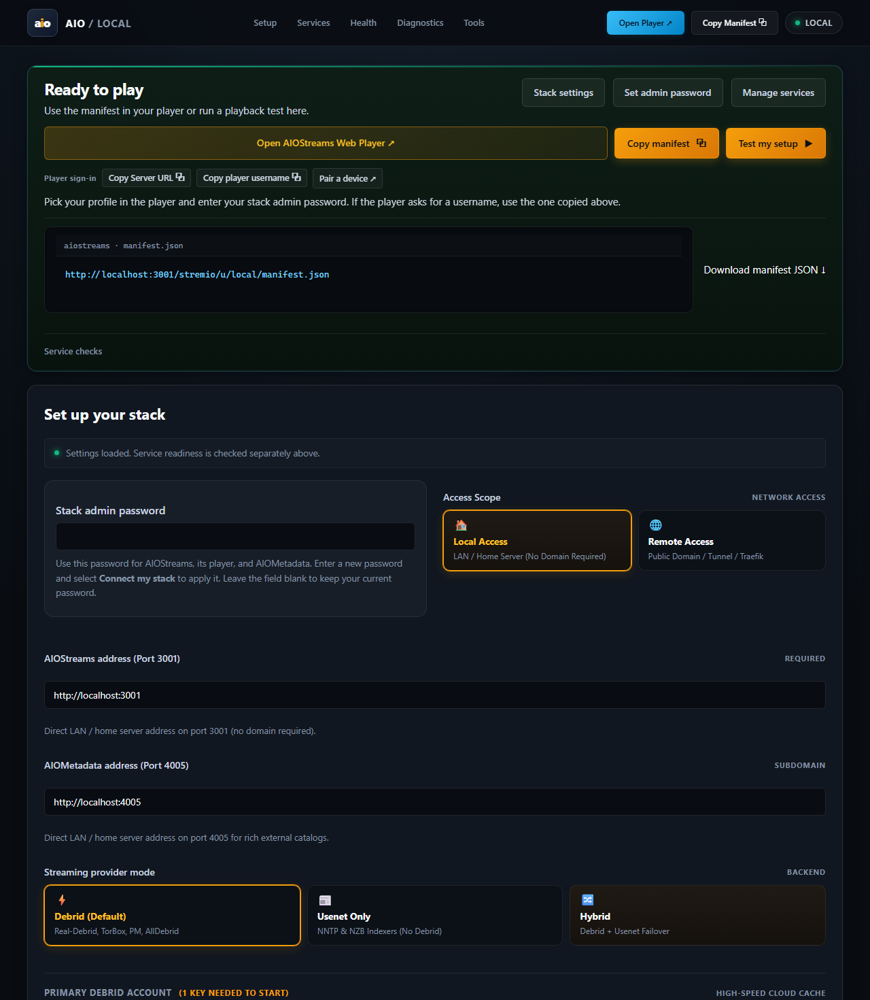
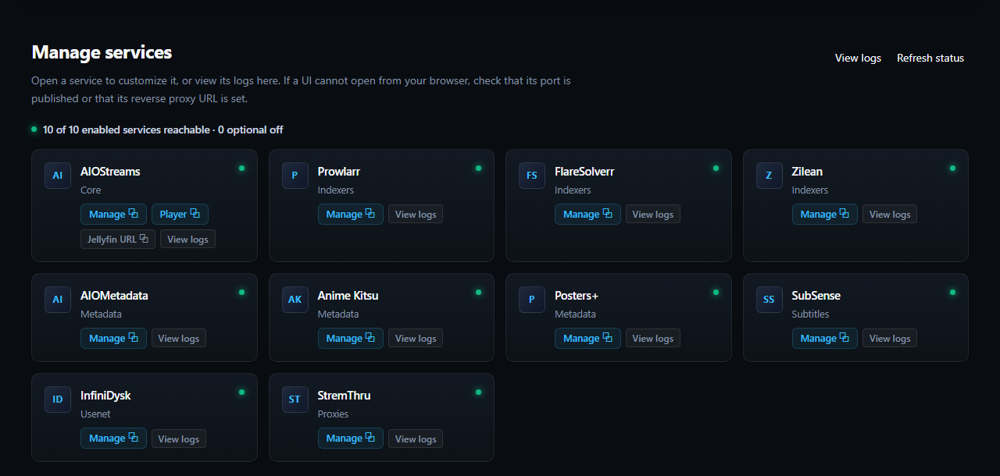
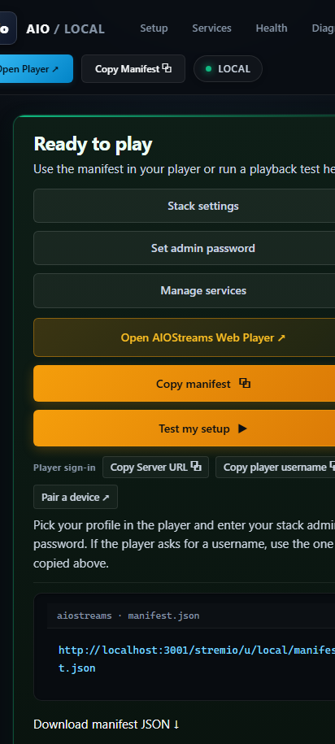
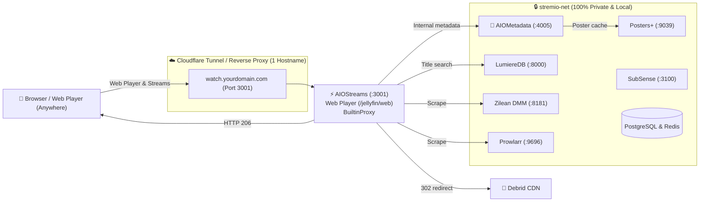

# AIO Local — v1.6.0

[](#-remote-playback--dual-subdomain-architecture)
[](LICENSE)

A self-hosted Docker Compose streaming backend built around **AIOStreams**. Enter your provider keys in the portal, connect the stack, and copy the generated manifest URLs into Stremio or Nuvio.

> [!NOTE]
> Only **AIOStreams (`:3001`)** and **AIOMetadata (`:4005`)** are exposed externally. All other services bind to `127.0.0.1` on the host and communicate only on the internal `stremio-net` Docker network.

---

## ⚡ Quick Start

**Three steps:**

1. **Deploy** — clone the repo and start the stack, or import `compose.manager.yml` into Portainer/Dockge.
2. **Open portal** — `http://YOUR-SERVER:8088` → enter provider and metadata keys → click **Connect my stack**.
3. **Copy manifest** — paste the generated AIOStreams manifest URL into Stremio or Nuvio.

### Option A: Git + Docker Compose

```sh
git clone https://github.com/oOflyeyesOo/AIOStreams-All-Local.git aio
cd aio
cp .env.example .env          # edit keys as needed
docker compose --profile scrapers up -d
```

Then open `http://localhost:8088`.

### Option B: Docker Management App (Portainer / Dockge)

Import **`compose.manager.yml`** as a new stack. Set environment variables in the app's UI, then deploy. See [COMPOSE.md](COMPOSE.md) for variable reference and [DEPLOYMENT.md](DEPLOYMENT.md) for a full walkthrough.

---

## 📸 Screenshots

### Setup & Manifest Generator (`:8088`)

<p align="center">
  
</p>

### Live Integration Status (`:8088#integrations`)

<p align="center">
  
</p>

### Responsive Mobile Setup

<p align="center">
  
</p>

---

## 🔒 Remote Playback & Ingress Architecture

You can expose your stack for remote playback using either a **Single-Host Web Player setup** (recommended) or a **Dual-Subdomain Stremio setup**:

### Mode 1: Web Player Ingress (Recommended — 1 Hostname, AIOMetadata Stays Local)

If you watch via the embedded **AIOStreams Web Player** (`/jellyfin/web/`), you only need **one public hostname**:

1. **Web Player & AIOStreams** — `watch.yourdomain.com` → Port `3001` (`http://aiostreams:3000`)

> [!TIP]
> **AIOMetadata stays 100% private and local!** AIOStreams connects to AIOMetadata directly over the internal Docker network (`stremio-net`). The client browser talks only to the Web Player. All scrapers, databases, and metadata services remain unexposed.



### Mode 2: Native Stremio Remote Addons (Optional — 2 Subdomains)

Only needed if you install both addons into a standalone native Stremio app on a phone or Android TV operating outside your home network:

1. **AIOStreams** — `aio.yourdomain.com` → Port `3001`: stream aggregation, scraper fan-out, BuiltinProxy, Debrid CDN handoff.
2. **AIOMetadata** — `aiometa.yourdomain.com` → Port `4005`: catalogs, poster badges, anime metadata.

See [docs/CLOUDFLARE-AND-WEB-PLAYER.md](docs/CLOUDFLARE-AND-WEB-PLAYER.md) for step-by-step instructions with Cloudflare Zero Trust (zero open router ports).

**Network binding:** Set `INTERNAL_BIND_IP=127.0.0.1` (default) to block unauthenticated access on a public VPS. For a home NAS needing LAN dashboard access, set `INTERNAL_BIND_IP=0.0.0.0`.

**BuiltinProxy:** All debrid playback routes through the server's public IP (`FORCE_PROXY_PROXIED_SERVICES`), so Real-Debrid and Premiumize only ever see one IP regardless of how many devices stream simultaneously.

---

## 🎛️ Stack Profiles

| Profile | Command | RAM | What runs |
| :--- | :--- | :--- | :--- |
| **`core`** | `docker compose --profile core up -d` | ~1.1 GB | AIOStreams, AIOMetadata, LumiereDB, Posters+, SubSense, Postgres, Redis, Portal |
| **`scrapers`** | `docker compose --profile scrapers up -d` | ~2.8 GB | `core` + Prowlarr, Zilean, Anime Kitsu, StremThru, InfiniDysk, FlareSolverr |
| **`all`** | `docker compose --profile all up -d` | ~3.1 GB | Full stack including optional integrations |

Set a default in `.env` with `COMPOSE_PROFILES=core` or pass the profile to `setup.sh`/`setup.ps1` directly.

See [docs/ANIME-AND-PROFILES.md](docs/ANIME-AND-PROFILES.md) for application-level profiles (AIOStreams flagship, Usenet-only, Anime-only) and [docs/STREAMING-PATH.md](docs/STREAMING-PATH.md) for end-to-end architecture.

---

## 🏗️ What is Integrated

| Category | Service | Purpose |
| :--- | :--- | :--- |
| **Core Aggregator** | AIOStreams (`:3001`) | Super-addon aggregator, filtering engine, BuiltinProxy, manifest generator |
| **Metadata & Catalogs** | AIOMetadata (`:4005`) | Rich streaming-provider catalogs (Netflix, Disney+, Apple TV+, Max, Prime, Anime) |
| **Portal & Watchdog** | Portal (`:8088`), Controller | Setup wizard, manifest exporter, automated backups, live integration monitor |
| **Search Index** | LumiereDB (`:8000`) | IMDb SQLite catalog search index (always up with AIOMetadata on `core` profile) |
| **Indexers & Cache** | Prowlarr (`:9696`), Zilean (`:8181`) | Auto-provisioned torrent indexers, DMM hash cache (<100 ms lookup) |
| **Cloudflare Bypass** | FlareSolverr (`:8191`) | Unblocks Cloudflare-protected indexers for Prowlarr |
| **Artwork** | Posters+ (`:9039`) | IMDb/Trakt/MAL rating badge overlays on poster art |
| **Subtitles** | SubSense (`:3100`) | Multi-provider subtitle aggregator (OpenSubtitles, SubSource, SubDL, YIFY) |
| **Anime Metadata** | Anime Kitsu (`:7005`) | Kitsu → IMDb/TVDB ID mapping for correct scraper lookups |
| **Debrid Store** | StremThru (`:8080`) | Personal debrid cloud library catalog + stream proxying |
| **Usenet** | InfiniDysk (`:3005`) | High-throughput Usenet / WebDAV streaming engine |
| **Databases** | PostgreSQL 16, Redis 7 | Shared backends for Zilean and AIOMetadata |

Trakt, Simkl, AniList, and subtitle/debrid providers are configured through the bundled services — not additional containers.

> [!NOTE]
> Jikan support for anime schedules and fillers is pre-configured via Tenrai (`https://api.tenrai.org/v4`), or can be pointed to a self-hosted instance using `JIKAN_API_BASE`.

---

## 🚀 Portal Walkthrough

Open `http://YOUR-SERVER:8088`:

1. Set **AIOStreams address** (`https://aio.yourdomain.com` or `http://localhost:3001`) and **AIOMetadata address**.
2. Enter your Debrid provider key and metadata keys (TMDB, TVDB, Fanart, MDBList).
3. Click **Connect my stack** — the portal saves `.env`, provisions indexers and databases, configures AIOMetadata presets, and activates the AIOStreams profile.
4. Copy the manifest URLs into your player.

**Customize addons:** Open **Configure AIOStreams** to edit the streaming profile or **Configure AIOMetadata** to change catalogs and artwork. Sign in to AIOStreams as `admin` with `ADDON_PASSWORD`; AIOMetadata uses the same password.

**Admin password:** Click **Set admin password**, enter a new password, then click **Connect my stack**. A blank field keeps the current password.

**Health endpoints:**
- `/healthz` — portal process alive
- `/ready` — AIOStreams dependency responding
- `/manifest-ready` — AIOStreams manifest has an ID and stream resources
- `/api/diagnostics` — authenticated, credential-redacted diagnostics
- `/version` — current portal version

---

## 🔑 Credentials & Upgrades

- Keys stay in your local `.env`. The portal never prints stored secrets — only a `SAVED` indicator.
- `setup.sh` generates unique cryptographic keys (`SECRET_KEY`, `POSTGRES_PASSWORD`, `PROWLARR_API_KEY`, etc.) on first run.
- **Do not commit `.env` or `data/`** — both are in `.gitignore`.

**Upgrade:**

```sh
git pull --ff-only origin main
docker compose pull --ignore-buildable
docker compose up -d --build
```

Then open the portal and click **Connect my stack** to re-verify manifests.

**Internet-facing:** Keep port `8088` on the administration network. If you must expose it publicly, set `PORTAL_AUTH_REQUIRED=true` and configure `ADDON_PASSWORD`. Only expose ports `3001` and `4005` through a TLS reverse proxy or Cloudflare Tunnel.

---

## 🧪 Testing

```sh
# Unit & provisioning tests
docker compose -p aio-tests -f compose.test.yml run --rm tests
docker compose -p aio-tests -f compose.test.yml run --rm browser-tests
docker compose -p aio-tests -f compose.test.yml run --rm database-test
docker compose -p aio-tests -f compose.test.yml down --volumes

# End-to-end (live stack required)
docker exec aio-portal python3 /app/tests/check_all_services_e2e.py

# Playback probe (HTTP 206 via BuiltinProxy)
docker exec aio-portal python3 /app/tests/check_playback.py
```

---

## 🧩 Custom Stack Builder

Generate a stripped-down Compose setup with selected services: open [`tools/stack-builder/index.html`](tools/stack-builder/index.html) in any browser. 100% client-side — produces a tailored `docker-compose.yml`, `.env`, and `01-init-dbs.sql`.

---

## 📖 Further Reading

| Document | Contents |
| :--- | :--- |
| [DEPLOYMENT.md](DEPLOYMENT.md) | Full deployment walkthrough, environment variables, upgrade procedures |
| [COMPOSE.md](COMPOSE.md) | Compose file reference, management-app import guide |
| [docs/STREAMING-PATH.md](docs/STREAMING-PATH.md) | End-to-end streaming path, transport details, curl diagnostics |
| [docs/ANIME-AND-PROFILES.md](docs/ANIME-AND-PROFILES.md) | Anime ecosystem, AniSkip, SeaDex, profile templates |
| [docs/IMMUTABLE-RELEASES.md](docs/IMMUTABLE-RELEASES.md) | Digest-pinned release bundles and recovery guide |
