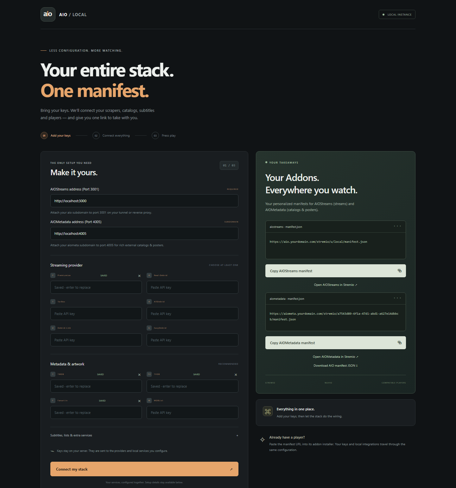
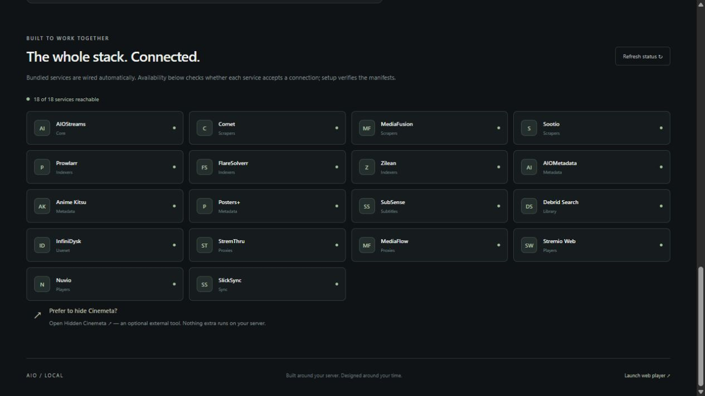
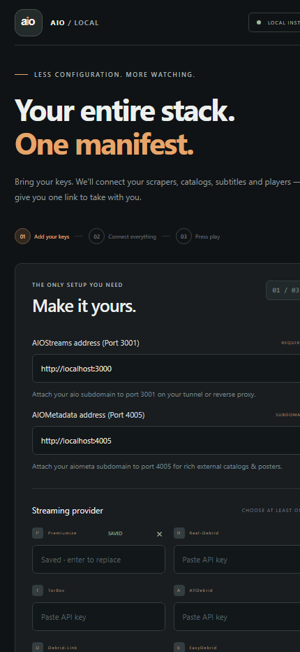

# AIO Local

A Docker Compose streaming stack centered on AIOStreams. Enter your provider keys in one setup page, connect the bundled services, and copy your manifest URL into Stremio or another compatible addon player. Services run locally; metadata, indexers and debrid providers still require internet access.

## Install

**Portainer, Dockge or NAS:** paste [compose.manager.yml](compose.manager.yml) into a Compose stack editor, set `ADDON_PASSWORD`, and deploy. It uses prebuilt Linux amd64 images and named volumes, with no source checkout. See [DEPLOYMENT.md](DEPLOYMENT.md) for image availability, registry authentication and upgrade instructions.

**Source checkout:** clone this repository, copy `.env.example` to `.env`, and run:

```sh
docker compose --profile all up -d --build --remove-orphans
```

Open `http://YOUR-SERVER:8088`, sign in as `admin` with your `ADDON_PASSWORD` (default `admin`), enter your server address and provider keys, then choose **Connect my stack**. Copy the resulting manifest URL into your player's addon installer. You can also download the manifest JSON; player support for file imports varies.

Use an address your player can reach: for example `http://YOUR-SERVER:3001` on a trusted LAN or your HTTPS AIOStreams domain. Optional AIOMetadata has its own address on port 4005. Provider entitlements and indexer availability affect what streams are returned.

The setup helper uses the host Docker socket to apply changed settings to this project's containers. It has broad Docker-engine authority. Only the helper mounts the socket; the portal talks to it over a local Unix socket. Keep portal access restricted to trusted administrators. See [COMPOSE.md](COMPOSE.md).

## One-page setup

Keys, setup progress, manifest cards and integration status share one page. Saved keys are masked and are not returned to the browser.







## Included integrations

| Purpose | Services |
| --- | --- |
| Aggregation | AIOStreams, builtin proxy and local templates |
| Scraping and indexing | Comet, MediaFusion, Sootio, Prowlarr, Zilean, FlareSolverr |
| Metadata and subtitles | AIOMetadata, Anime Kitsu, Posters+, SubSense |
| Debrid and routing | Debrid Search, StremThru, MediaFlow |
| Usenet | InfiniDysk; requires a Usenet provider and suitable indexers |
| Players and synchronization | Stremio Web, Nuvio Web, SlickSync |
| Storage | PostgreSQL and Redis |

The bootstrap configures available service APIs and seeds public indexers. Service status checks show connectivity, not a guarantee of successful playback. Some providers need additional credentials or configuration.

[Hidden Cinemeta](https://hidden-cinemeta.vercel.app/) is an optional external link in the portal. This stack no longer builds or runs a Cinemeta-removal container. Upgrading with `--remove-orphans` removes the old container in the same Compose project.

## Network access

Ports 8088 (setup), 3001 (AIOStreams) and 4005 (AIOMetadata) are published on the host. Other application ports bind to `127.0.0.1` by default. Databases are reached over the private Docker network.

For remote players, configure HTTPS with your existing reverse proxy:

- `aio.example.com` routes to port 3001; set `BASE_URL` to that HTTPS address.
- `aiometa.example.com` routes to port 4005; set `AIOMETADATA_HOST` accordingly.

For direct access to Stremio Web (8082), Nuvio (8085) or internal dashboards from a trusted LAN, set `INTERNAL_BIND_IP` to your server's LAN IP. Use `0.0.0.0` only when your firewall restricts those ports appropriately. Never put `localhost` in a manifest intended for another device.

## Deployment choices and updates

- [Manager deployment](DEPLOYMENT.md): prebuilt component images, persistent named volumes, full stack without profile setup. Pin `AIO_IMAGE_TAG` to a successful build's commit SHA for repeatable packaged-component versions.
- [Source deployment](COMPOSE.md): editable Compose definitions and bind-mounted data. `.env.example` enables the `all` profile. Smaller source profiles are available, but combinations must include their service dependencies.
- [Offline stack builder](tools/stack-builder/README.md): optional source configuration tool, separate from the setup portal.
- `docker-compose.aio.yml`: legacy privileged Docker-in-Docker appliance. Prefer the manager deployment for a new NAS installation.

Back up `.env` and `data/` for source installs, or all named volumes for manager installs, before upgrades. Keep encryption keys and application data together. Replacing a container must not remove its volumes. After a manager redeploy, choose **Connect my stack** to reapply keys saved in the portal.

Initial cache downloads can take several minutes and consume CPU. Zilean resource limits are adjustable in `.env`. Docker logs rotate at 10 MB with three retained files per container.

## Verification

Run the isolated regression suite from a source checkout:

```sh
docker compose -p aio-tests -f compose.test.yml run --rm tests
docker compose -p aio-tests -f compose.test.yml run --rm database-test
docker compose -p aio-tests -f compose.test.yml run --rm browser-tests
docker compose -p aio-tests -f compose.test.yml down --volumes
```

Check the running full stack without changing its configuration:

```sh
docker compose --profile all --profile test run --rm stack-check
```

`tests/check_streams.py`, `tests/check_playback.py` and `tests/benchmark_pathways.py` provide additional live probes. These depend on credentials and external services; endpoint tests and a short byte-range playback probe do not establish uninterrupted movie playback. Do not publish diagnostic output containing provider or personalized manifest URLs.

## Related project

[easy-aiostreams](https://github.com/alpinezx/easy-aiostreams) is a useful reference for maintenance, backup/restore and HTTPS setup. Its installer manages a fresh VPS. This project keeps Compose and an existing Docker manager in control. Current maintenance improvements include bounded logs, persistent configuration and versioned component images. Scheduled backups, automatic rollback and VPN management are not implemented here.
