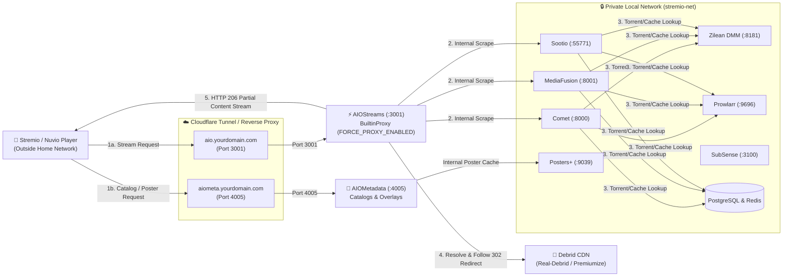

# AIO Local

[](#-what-is-integrated)
[](#-automated-testing--verification)
[](#-remote-playback--dual-subdomain-architecture)
[](LICENSE)

A 100% self-hosted Docker Compose streaming backend centered on **AIOStreams**. Enter your provider keys in one setup screen, let the stack wire all 18 bundled application services together on your private Docker network (`stremio-net`), and copy your personalized manifest URLs directly into Stremio or any compatible player.

The interface is one page: keys, setup progress, the main AIOStreams manifest, an optional standalone metadata manifest, service health and maintenance. Installing both manifests can duplicate catalogs.

For reproducible deployments, use the [digest-pinned release bundle and recovery guide](docs/IMMUTABLE-RELEASES.md). See the [request ownership map and timed routing results](docs/ROUTING-VALIDATION.md) for tested paths and limits.

---

## 📸 Visual Previews & Screenshots

### 1. Unified Setup & Manifest Generator (`:8088` / `index.html`)
> Saved-key indicators, automatic service configuration, and dual personalized takeaway manifests for AIOStreams and AIOMetadata.

<p align="center">
  
</p>

### 2. Live Integration Status (`:8088#integrations`)
> All bundled application services grouped by purpose with real-time connection checks and database handshakes.

<p align="center">
  
</p>

### 3. Responsive Mobile Experience
> Clean, responsive design for easy setup and direct manifest installation on iOS, Android, and tablets.

<p align="center">
  
</p>

---

### Readiness and maintenance

Configuration, authorization and playback are labeled separately. Resource use,
backup coverage, search activity and confirmed cache cleanup stay on the same page.
These screenshots use a disposable stack with no provider keys.


## 🔒 Remote Playback & Dual Subdomain Architecture

For remote playback, route these two endpoints through your reverse proxy or tunnel. Keep the portal and other published dashboards on a trusted network, and review the actual Compose port bindings:
1. **AIOStreams (`aio.yourdomain.com` ➔ Port 3001)**: Aggregates streams, queries local scrapers, proxies requests through `BuiltinProxy`, and handles Debrid CDN stream handoffs.
2. **AIOMetadata (`aiometa.yourdomain.com` ➔ Port 4005)**: Serves rich catalogs (Netflix, Prime, Disney+, Apple TV+, Max, Anime) and poster artwork badges directly to players anywhere in the world.

All other microservices (Comet, MediaFusion, Sootio, Zilean, Prowlarr, Posters+, SubSense, Postgres, Redis, etc.) remain strictly internal to the Docker network (`stremio-net`) and bind to loopback (`127.0.0.1`) on the host.



* **Internal Loopback Binding (`INTERNAL_BIND_IP=127.0.0.1`)**: Internal scrapers, indexers, and proxies bind to `127.0.0.1` on the host, preventing unauthenticated access from the public internet even on a VPS where Docker bypasses UFW. For private home LAN NAS deployments needing direct LAN dashboard access, set `INTERNAL_BIND_IP=0.0.0.0` in `.env`.
* **Built-in Stream Proxying**: AIOStreams' `BuiltinProxy` intercepts stream requests and transforms scraper links (e.g. `http://sootio:55771/...` or `http://comet:8000/...`) into secure proxy endpoints (`${BASE_URL}/api/v1/proxy/...`).
* **Debrid CDN Redirect Handling**: When playing media, AIOStreams follows the provider's 302 redirect internally and streams video bytes directly to your player over HTTP 206 Partial Content.

---

## 🚀 Quick Start

### 1. Launch the Stack
```sh
./setup.sh start
```

The setup script creates `.env` and generates a unique portal password before
starting Compose. For manual Compose usage, set `ADDON_PASSWORD` in `.env`
first; the portal intentionally has no built-in password fallback.

### 2. Configure via Setup Portal
Open **`http://YOUR-SERVER:8088`** and sign in with username `admin` and your
`ADDON_PASSWORD`. Fresh installs generate a random password; retrieve it from
the generated `.env` file and change it during setup if desired.
1. Set your server addresses:
   - **AIOStreams address**: `https://aio.yourdomain.com` (or `http://localhost:3001` for local play)
   - **AIOMetadata address**: `https://aiometa.yourdomain.com` (or `http://localhost:4005`)
2. Enter your streaming provider key (Real-Debrid, Premiumize, TorBox, AllDebrid, Debrid-Link, EasyDebrid, Offcloud, Seedr).
3. Enter your metadata keys (TMDB, TVDB, Fanart, MDBList).
4. Click **Connect my stack**.

The portal automatically saves `.env` safely, provisions indexers and databases, configures AIOMetadata presets with Posters+, and activates the AIOStreams super-addon profile. Once complete, copy the manifest URLs directly into your player.

After entering provider and metadata keys, use **Download optimized profile
JSON** in the portal to retrieve the generated AIOStreams profile. This is the
same optimized configuration used by bootstrap; the download is authenticated
and contains the configured provider credentials, so keep it private.

For monitoring and reverse-proxy health checks, the portal exposes:

- `/healthz` — portal process is responding.
- `/ready` — the AIOStreams dependency is responding.
- `/manifest-ready` — the local AIOStreams manifest has an ID and stream resources.
- `/api/diagnostics` — authenticated, credential-redacted core-path diagnostics.
- `/version` — current portal version.

### 3. Automation and maintenance commands

The repository includes a portable `Makefile` for non-interactive validation and
maintenance. These commands use the same Compose files as the Linux and
Windows management scripts:

```sh
make validate
make test
make build
make backup
make restore ARCHIVE=/path/to/aio-backup.tar.gz
make integrations       # report configured optional adapters without secrets
make e2e                 # requires a running aio-portal container
```

Use `./setup.sh` or `setup.ps1` for interactive startup, profile selection,
status, updates, resource monitoring, and cache cleanup.

---

## 🎛️ Stack Profiles (Resource Tuning)

Modular Docker Compose profiles allow you to run a lean, fast setup on low-resource machines or launch the complete appliance:

| Profile | Launch Command | RAM Usage | Included Services |
| :--- | :--- | :--- | :--- |
| **`core`** (Recommended Lean) | `docker compose --profile core up -d` | **~1.1 GB** | AIOStreams, Comet, AIOMetadata, Posters+, SubSense, PostgreSQL, Redis, Portal |
| **`scrapers`** | `docker compose --profile scrapers up -d` | **~3.5 GB** | Core + MediaFusion, Sootio, Zilean (DMM Cache), Prowlarr, FlareSolverr, Debrid-Search |
| **`proxies`** | `docker compose --profile proxies up -d` | **~1.8 GB** | Core + MediaFlow, StremThru, InfiniDysk Usenet Engine |
| **`web`** | `docker compose --profile web up -d` | **~1.6 GB** | Core + Stremio Web Player, Nuvio Web Player, SlickSync Hub |
| **`all`** (Default) | `docker compose up -d` | **~4.5 GB** | Full appliance with all 18 application services active |

> [!TIP]
> The setup scripts start the `all` profile when no profile is selected. You can set a lean default in `.env` using `COMPOSE_PROFILES=core`, or run directly with `./setup.sh start core` or `.\setup.ps1 -Start -Profile core`. The bootstrapper still creates the AIOStreams manifest if optional metadata services are unavailable; those providers are omitted until their profile is enabled.

---

## 🏗️ What is Integrated

| Category | Bundled Services | Purpose |
| :--- | :--- | :--- |
| **Core Aggregator** | AIOStreams (`:3001`) | Super-addon aggregator, filtering engine, BuiltinProxy & Stremio manifest generator |
| **Management** | AIO Portal (`:8088`) | Central setup wizard, dual manifest exporter, and live 18-service integration monitor |
| **Scrapers** | Comet (`:8000`), MediaFusion (`:8001`), Sootio (`:55771`) | Fast torrent & multi-source scrapers querying local Prowlarr and Zilean |
| **Indexers & Cache** | Zilean (`:8181`), Prowlarr (`:9696`), FlareSolverr (`:8191`) | DMM hash cache (<100ms lookup), tracker manager with automatically provisioned public indexers, and Cloudflare bypass |
| **Metadata & Artwork** | AIOMetadata (`:4005`), Posters+ (`:9039`), Anime Kitsu (`:7005`) | Rich streaming-provider catalogs (Netflix, Disney+, Apple TV+, Max, Prime), rating badges, and local anime metadata |
| **Subtitles** | SubSense (`:3100`) | Multi-provider subtitle aggregator (OpenSubtitles, SubSource, SubDL, YIFY) with WARP routing |
| **Personal Library** | Debrid Search (`:3011`) | Instant library search querying personal Real-Debrid / TorBox / Premiumize cloud cache |
| **Stream Proxies** | StremThru (`:8080`), MediaFlow-Proxy (`:8888`) | Debrid store caching, stream proxying, live stream and HLS transcoding |
| **Usenet Engine** | InfiniDysk (`:3005`) | High-throughput Usenet and WebDAV streaming engine |
| **Web Players & Sync** | Nuvio Web (`:8085`), Stremio Web (`:8082`), SlickSync (`:8086`) | Modern web players, Trakt sync hub, collections builder, and addon sync |
| **Databases** | Shared PostgreSQL 16, Shared Redis 7 | High-performance backends for Zilean, MediaFusion, Comet, and AIOMetadata |

The 18-service count covers application containers monitored by the portal.
The portal itself, PostgreSQL, Redis, one-shot initialization jobs, and the
optional Cloudflare Tunnel are infrastructure and are counted separately.
Trakt, Simkl, AniList, Gemini, and the subtitle/debrid providers are adapters
configured through the bundled AIOStreams, AIOMetadata, SlickSync, and
SubSense services rather than additional containers.

---

## 🧪 Automated Testing & Verification

The project includes continuous integration unit tests, database provisioning tests, and live end-to-end integration probes:

```sh
# 1. Continuous Integration Regression Test Suite (Unit & database provisioning tests)
docker compose -p aio-tests -f compose.test.yml run --rm tests
docker compose -p aio-tests -f compose.test.yml run --rm browser-tests
docker compose -p aio-tests -f compose.test.yml run --rm database-test
docker compose -p aio-tests -f compose.test.yml down --volumes

# 2. Comprehensive End-to-End Suite (Live queries, cache, scraper, and playback through the full stack)
docker exec aio-portal python3 /app/tests/check_all_services_e2e.py

# 3. Remote Playback Probe (HTTP 206 Partial Content byte streaming via AIOStreams BuiltinProxy)
docker exec aio-portal python3 /app/tests/check_playback.py
```

---

## 🔑 Credentials and Upgrades

Keys remain in your local `.env`, service configuration, and Docker environment. The Setup Portal never prints stored secrets back to the browser; only a `SAVED` indicator is displayed.

- **Unique Secret Generation**: `setup.sh` automatically generates unique cryptographic keys for all internal services (`SECRET_KEY`, `POSTGRES_PASSWORD`, `PROWLARR_API_KEY`, etc.) when creating `.env`.
- **Do not commit `.env` or `data/`**: The `.dockerignore` and `.gitignore` exclude all local runtime storage and credentials.
- **Upgrades**:
  ```sh
  git pull --ff-only origin main
  docker compose pull --ignore-buildable
  docker compose up -d --build
  ```
  Then open the portal and choose **Connect my stack** to re-verify manifests and refresh services.

### Internet-facing deployment

The portal requires `ADDON_PASSWORD` to be generated by `setup.sh` or supplied
in `.env`; Compose no longer supplies the insecure `admin` fallback for the
portal. Authentication failures are rate-limited, state-changing requests
reject foreign origins, and portal responses disable caching and framing.
Expose only ports 3001 and 4005 through a TLS reverse proxy or Cloudflare
Tunnel; keep port 8088 restricted to the administration network.

---

## 🧩 Standalone Custom Stack Builder (Offline Tool)

If you ever want to generate a custom, stripped-down Compose setup with selected microservices, use the standalone [Custom Stack Builder](tools/stack-builder):
* Open [`tools/stack-builder/index.html`](tools/stack-builder/index.html) directly in any browser.
* **100% client-side** and uncoupled from the rest of the running stack.
* Generates tailored `docker-compose.yml`, `.env`, and `01-init-dbs.sql` files for custom or manual deployments.


Current validation: 106 Python regression tests and eight browser checks, image-only startup, portal apply, fixture upgrade/rollback and timed movie/episode fallback tests. Earlier movie/episode decode evidence is in [release validation](docs/RELEASE-VALIDATION.md); current [routing validation](docs/ROUTING-VALIDATION.md) distinguishes media reads from decoding and public-address checks. Sootio now runs as conditional fallback by default; `SOOTIO_MODE=off` disables it and `parallel` opts into simultaneous scraping.
