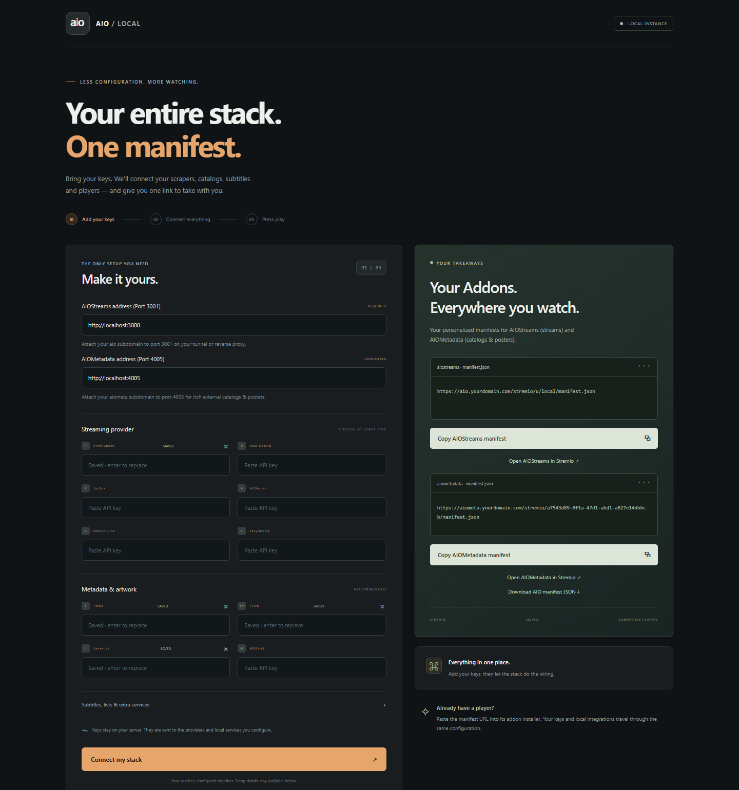
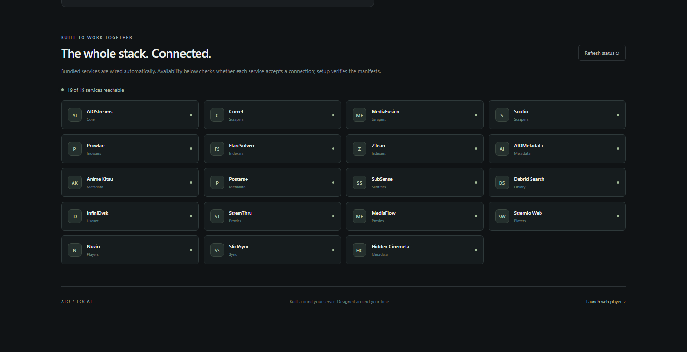
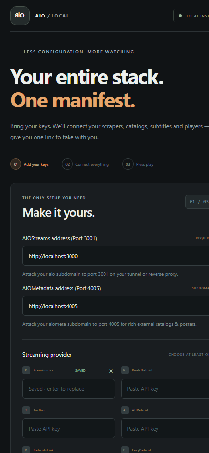
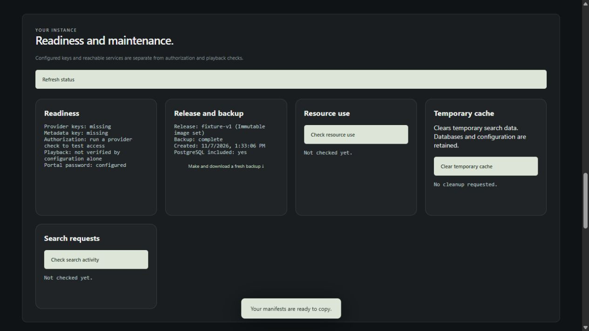
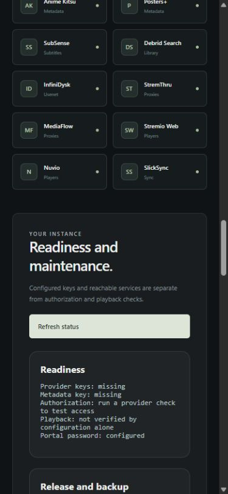
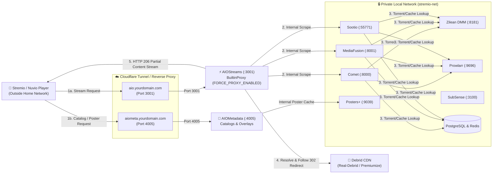

# AIO Local


[](#-what-is-integrated)

[](#-automated-testing--verification)

[](#-remote-playback--dual-subdomain-architecture)

[](LICENSE)


A 100% self-hosted Docker Compose streaming backend centered on **AIOStreams**. Enter your provider keys in one setup screen, let the stack wire all 22 bundled services together on your private Docker network (`stremio-net`), and copy your personalized manifest URLs directly into Stremio or any compatible player.


MediaFusion is optional and off by default. The portal can configure a Usenet provider and a Newznab indexer from input fields. Torrentio runs once through AIOStreams for additional coverage; [source comparisons and Usenet acceptance](docs/OPTIONAL-SOURCES-VALIDATION.md) explain the measured benefits and limits.


The interface is one page: keys, setup progress, the main AIOStreams manifest, an optional standalone metadata manifest, service health and maintenance. Installing both manifests can duplicate catalogs.


For reproducible deployments, use the [digest-pinned release bundle and recovery guide](docs/IMMUTABLE-RELEASES.md). See the [end-to-end streaming path & transport guide](docs/STREAMING-PATH.md), the [anime ecosystem & profile guide](docs/ANIME-AND-PROFILES.md), and the [request ownership map](docs/ROUTING-VALIDATION.md) for detailed architecture, proxy shielding, anime capabilities, and tested limits.


[Download the tested Compose release bundle](https://github.com/oOflyeyesOo/AIOStreams-All-Local/actions/runs/42433774822/artifacts/13598986164) for management-app deployment. This replacement release fixes the first-start authentication migration crash and passed a fresh Linux install with zero AIOStreams restarts. Extract the archive and use its `compose.release.yml`; retain its lock file for upgrades.


---


## 📸 Visual Previews & Screenshots


### 1. Unified Setup & Manifest Generator (`:8088` / `index.html`)

> Saved-key indicators, automatic service configuration, and dual personalized takeaway manifests for AIOStreams and AIOMetadata.


<p align="center">

  

</p>


### 2. Live Integration Status (`:8088#integrations`)

> All bundled application services grouped by purpose with real-time connection checks and database handshakes.


<p align="center">

  

</p>


### 3. Responsive Mobile Experience

> Clean, responsive design for easy setup and direct manifest installation on iOS, Android, and tablets.


<p align="center">

  

</p>


---


### Readiness and maintenance


Configuration, authorization and playback are labeled separately. Resource use,

backup coverage, search activity and confirmed cache cleanup stay on the same page.

These screenshots use a disposable stack with no provider keys.








## 🔒 Remote Playback & Dual Subdomain Architecture


For remote playback, route these two endpoints through your reverse proxy or tunnel. Keep the portal and other published dashboards on a trusted network, and review the actual Compose port bindings:

1. **AIOStreams (`aio.yourdomain.com` ➔ Port 3001)**: Aggregates streams, queries local scrapers, proxies requests through `BuiltinProxy`, and handles Debrid CDN stream handoffs.

2. **AIOMetadata (`aiometa.yourdomain.com` ➔ Port 4005)**: Serves rich catalogs (Netflix, Prime, Disney+, Apple TV+, Max, Anime) and poster artwork badges directly to players anywhere in the world.


All other microservices (Comet, MediaFusion, Sootio, Zilean, Prowlarr, Posters+, SubSense, Postgres, Redis, etc.) remain strictly internal to the Docker network (`stremio-net`) and bind to loopback (`127.0.0.1`) on the host.





* **Internal Loopback Binding (`INTERNAL_BIND_IP=127.0.0.1`)**: Internal scrapers, indexers, and proxies bind to `127.0.0.1` on the host, preventing unauthenticated access from the public internet even on a VPS where Docker bypasses UFW. For private home LAN NAS deployments needing direct LAN dashboard access, set `INTERNAL_BIND_IP=0.0.0.0` in `.env`.

* **Built-in Stream Proxying**: AIOStreams' `BuiltinProxy` intercepts stream requests and transforms scraper links (e.g. `http://sootio:55771/...` or `http://comet:8000/...`) into secure proxy endpoints (`${BASE_URL}/api/v1/proxy/...`).

* **Debrid CDN Redirect Handling**: When playing media, AIOStreams follows the provider's 302 redirect internally and streams video bytes directly to your player over HTTP 206 Partial Content.


---


## 🚀 Quick Start


### 1. Launch the Stack

```sh

./setup.sh start

```


The setup script creates `.env` and generates a unique portal password before

starting Compose. For manual Compose usage, set `ADDON_PASSWORD` in `.env`

first; the portal intentionally has no built-in password fallback.


### 2. Configure via Setup Portal

Open **`http://YOUR-SERVER:8088`** and sign in with username `admin` and your

`ADDON_PASSWORD`. Fresh installs generate a random password; retrieve it from

the generated `.env` file and change it during setup if desired.

1. Set your server addresses:

   - **AIOStreams address**: `https://aio.yourdomain.com` (or `http://localhost:3001` for local play)

   - **AIOMetadata address**: `https://aiometa.yourdomain.com` (or `http://localhost:4005`)

2. Enter your streaming provider key (Real-Debrid, Premiumize, TorBox, AllDebrid, Debrid-Link, EasyDebrid, Offcloud, Seedr).

3. Enter your metadata keys (TMDB, TVDB, Fanart, MDBList).

4. Click **Connect my stack**.


The portal automatically saves `.env` safely, provisions indexers and databases, configures AIOMetadata presets with Posters+, and activates the AIOStreams super-addon profile. Once complete, copy the manifest URLs directly into your player.


After entering provider and metadata keys, use **Download optimized profile

JSON** in the portal to retrieve the generated AIOStreams profile. This is the

same optimized configuration used by bootstrap; the download is authenticated

and contains the configured provider credentials, so keep it private.


For monitoring and reverse-proxy health checks, the portal exposes:


- `/healthz` — portal process is responding.

- `/ready` — the AIOStreams dependency is responding.

- `/manifest-ready` — the local AIOStreams manifest has an ID and stream resources.

- `/api/diagnostics` — authenticated, credential-redacted core-path diagnostics.

- `/version` — current portal version.


### 3. Automation and maintenance commands


The repository includes a portable `Makefile` for non-interactive validation and

maintenance. These commands use the same Compose files as the Linux and

Windows management scripts:


```sh

make validate

make test

make build

make backup

make restore ARCHIVE=/path/to/aio-backup.tar.gz

make integrations       # report configured optional adapters without secrets

make e2e                 # requires a running aio-portal container

```


Use `./setup.sh` or `setup.ps1` for interactive startup, profile selection,

status, updates, resource monitoring, and cache cleanup.


---


## 🎛️ Stack Profiles & Configuration Templates

Modular Docker Compose profiles allow you to scale your deployment from a lean, ultra-light setup on low-resource machines to the complete 22-microservice appliance:

### 1. Docker Compose Resource Profiles

| Profile | Launch Command | RAM Usage | Included Services & Description |
| :--- | :--- | :--- | :--- |
| **`core`** (Recommended Lean) | `docker compose --profile core up -d` | **~1.1 GB** | AIOStreams, Comet, AIOMetadata, Posters+, SubSense, PostgreSQL, Redis, Portal. Ideal for low-memory VPS relying on Comet and Torrentio. |
| **`scrapers`** | `docker compose --profile scrapers up -d` | **~3.5 GB** | Core + MediaFusion, Sootio, Zilean (DMM Cache), Prowlarr, FlareSolverr, Debrid-Search, and Anime Kitsu. |
| **`proxies`** | `docker compose --profile proxies up -d` | **~1.8 GB** | Core + MediaFlow, StremThru proxy router, InfiniDysk Usenet Engine. |
| **`web`** | `docker compose --profile web up -d` | **~1.6 GB** | Core + Stremio Web Player (with AniSkip), Nuvio Web Player, SlickSync Hub. |
| **`usenet`** | `docker compose --profile usenet up -d` | **~2.2 GB** | Core + InfiniDysk (`:3005`), NZBDav, and Prowlarr Newznab indexers for direct NNTP streaming. |
| **`all`** (Default) | `docker compose up -d` | **~4.5 GB** | Full appliance with all 22 microservices running on `stremio-net`. |

> [!TIP]
> The setup scripts start the `all` profile when no profile is selected. You can set a lean default in `.env` using `COMPOSE_PROFILES=core`, or run directly with `./setup.sh start core` or `.\setup.ps1 -Start -Profile core`. The bootstrapper still creates the AIOStreams manifest if optional metadata services are unavailable; those providers are omitted until their profile is enabled.

### 2. Application Configuration Profiles

AIO Local bundles tailored setup profiles selectable via the portal (`:8088`) or `.env`:
- **AIOStreams Flagship (`all-local-selfhosted.json`)**: Default profile pre-configured with Tamtaro SEL expressions, Vidhin release regexes, SeaDex anime scoring, Comet, Zilean, Torrentio, SubSense subtitles, Debrid Search, and Anime Kitsu.
- **Tamtaro Anime Only (`tamtaro-anime-only.json`)**: Strips western TV rules to optimize strictly for anime releases, NekoBT, Tsukihime, AnimeTosho, SubsPlease, and dual-audio ranking.
- **AIOMetadata Catalogs (`with-anime` vs. `without-anime`)**: Choose between full mainstream catalogs plus 20+ dedicated anime catalogs (MAL schedules, season rows, studio spotlights) or clean movie/TV catalogs without anime rows.

See the [Anime Ecosystem & Profile Guide](docs/ANIME-AND-PROFILES.md) for full template definitions and customization steps.
---


## 🏗️ What is Integrated


| Category | Bundled Services | Purpose |

| :--- | :--- | :--- |

| **Core Aggregator** | AIOStreams (`:3001`) | Super-addon aggregator, filtering engine, BuiltinProxy & Stremio manifest generator |

| **Management & Watchdog** | AIO Portal (`:8088`), Stack Watchdog | Central setup wizard, dual manifest exporter, automated backups, and live integration monitor |

| **Scrapers** | Comet (`:8000`), MediaFusion (`:8001`), Sootio (`:55771`) | Fast torrent & multi-source scrapers querying local Prowlarr and Zilean |

| **Indexers & Cache** | Zilean (`:8181`), Prowlarr (`:9696`), Search Broker (`:8091`), FlareSolverr (`:8191`) | DMM hash cache (<100ms lookup), intelligent indexer caching/deduplication broker, auto-provisioned indexers, and Cloudflare bypass |

| **Metadata & Artwork** | AIOMetadata (`:4005`), Posters+ (`:9039`), Anime Kitsu (`:7005`) | Rich streaming-provider catalogs (Netflix, Disney+, Apple TV+, Max, Prime), rating badges, and local anime metadata |

| **Subtitles** | SubSense (`:3100`) | Multi-provider subtitle aggregator (OpenSubtitles, SubSource, SubDL, YIFY) with WARP routing |

| **Personal Library & Cloud** | Debrid Search (`:3011`), StremThru Store (`:8080/stremio/store`) | Instant library search & direct Stremio catalog mounting for personal Real-Debrid / TorBox / Premiumize cloud files |

| **Stream Proxies** | StremThru (`:8080`), MediaFlow-Proxy (`:8888`), Universal BuiltinProxy | Debrid store caching, stream proxying, multi-IP ban shield, and non-debrid HTTP stream shielding |

| **Usenet Engine** | InfiniDysk (`:3005`) | High-throughput Usenet and WebDAV streaming engine |

| **Web Players & Sync** | Stremio Web (`:8082`), Nuvio Web (`:8085`), SlickSync (`:8086`) | Modern web players with AniSkip (auto/hotkey skip) & player shortcuts, Trakt sync hub, collections builder |

| **Databases** | Shared PostgreSQL 16, Shared Redis 7 | High-performance backends for Zilean, MediaFusion, Comet, and AIOMetadata |


The 22-service count covers continuous application and platform containers monitored on `stremio-net`.

One-shot initialization jobs (database bootstrap, configuration provisioner) run at first boot and exit gracefully.

Trakt, Simkl, AniList, Gemini, and the subtitle/debrid providers are adapters

configured through the bundled AIOStreams, AIOMetadata, SlickSync, and

SubSense services rather than additional containers.


---


## 🎬 How the Streaming Path Works (End-to-End Architecture)

Every media query and stream playback undergoes a coordinated journey across the internal `stremio-net` microservices network. Below is the end-to-end data and transport flow:

```text
  [Stremio Player / Web / Mobile]
               │
               ▼
  1. Browse: AIOMetadata (:4005) + Posters+ badges (Cinemeta / TMDB / TVDB / MAL)
               │
               ▼
  2. Select: AIOStreams (:3000 / :3001) Stream Resolution
       ├── Intelligent Query Broker (:8091) ──► Prowlarr ──► FlareSolverr (Cloudflare bypass)
       ├── Primary Local Scrapers ────────────► Comet (:8000), Zilean DMM (:8181), Debrid Search (:8004)
       ├── Public & Community Databases ──────► Torrentio (~30ms cloud index), RemuxDB (MediaInfo audio/HDR)
       └── Adaptive Sequential Fallback ──────► Sootio (triggers ONLY if 0 cached streams found)
               │
               ▼
  3. Debrid Cache Probe & Filtering
       ├── Debrid API validation (RealDebrid, Premiumize, Torbox, StremThru Store)
       └── Tamtaro SEL Expressions, Vidhin Release Regexes, and SeaDex Anime Quality Ranking
               │
               ▼
  4. Stream Selection & Playback via BuiltinProxy:
     https://aio.yourdomain.com/playback/<token>/video.mkv
       │
       ├──► Multi-IP Ban Shield: Outbound connections originate from SERVER IP only
       │    (Real-Debrid & Premiumize see 1 IP even if multiple devices stream simultaneously)
       │
       ├──► Non-Debrid Host Shield ("none"): External HTTP/free streams proxied via server
       │
       └──► HTTP 206 Partial Content: Byte-range streaming for instant seeking & scrubbing
               │
               ▼
  5. In-Player Polish:
       ├── SubSense (:8001) ──► Subtitles (OpenSubtitles, SubDL, SubSource)
       └── Portal (:8088) ────► AniSkip intro/outro auto-skip + keyboard shortcut 's'
```

### Stage-by-Stage Breakdown

1. **Catalog & Metadata Discovery**:
   - The player requests catalogs from standalone **AIOMetadata** (`:4005`), pulling from Cinemeta, TMDB, TVDB, MAL/Jikan, and AniList.
   - **Posters+** overlays dynamic IMDb, Trakt, and MAL rating badges directly onto poster artwork.
   - Manifest partitioning ensures catalog feeds are served exclusively by AIOMetadata, preventing duplicate catalog rows in Stremio.

2. **Parallel Scraper Fan-Out & Request Coalescing**:
   - When a title is clicked, AIOStreams queries enabled scrapers in parallel.
   - The **Intelligent Search Broker** (`:8091`) coalesces identical in-flight indexer queries into one upstream call, caches results in memory for 60s (<20ms response), and bypasses Cloudflare challenges via FlareSolverr (`:8191`).
   - Primary local scrapers (**Comet**, **Zilean DMM cache**, **Debrid Search**, **Anime Kitsu**) return instant local results without external scraping delays.
   - Selectable public databases (**Torrentio** cloud index at ~30ms, **RemuxDB** MediaInfo specs) inject massive pre-indexed release coverage without local crawler overhead.

3. **Adaptive Sequential Fallback (`SOOTIO_MODE=fallback`)**:
   - Secondary multi-scrapers like **Sootio** run only when `count(cached(totalStreams)) == 0`.
   - If Comet, Zilean, or Torrentio return cached streams, Sootio remains idle—saving CPU, memory, and network bandwidth.

4. **Instant Debrid Cache Validation & SEL Scoring**:
   - Discovered infohashes are checked against the user's debrid provider API (Real-Debrid, Premiumize, Torbox, AllDebrid, Debrid-Link) or StremThru Store (`:8080`).
   - Streams are filtered, deduplicated, and ranked using **Tamtaro SEL expressions**, **Vidhin regexes**, and **SeaDex** community ranks. Optimal 4K Remuxes, Web-DLs, and dual-audio anime releases are sorted to the top.

5. **The Playback Transport & Multi-IP Ban Shield (Zero Concurrency Violations)**:
   - Streams are returned as proxied URLs: `https://aio.yourdomain.com/playback/<token>/video.mkv`.
   - When the user presses Play, the connection routes into AIOStreams' **BuiltinProxy**.
   - BuiltinProxy resolves the debrid download link using the **Docker host server's public IP address**.
   - **Crucial Protection**: Because `FORCE_PROXY_PROXIED_SERVICES` routes all video chunks through the server, Real-Debrid and Premiumize only ever observe **one single IP address** (the server's IP). Multiple household family members can stream simultaneously across cellular 5G, office, and home Wi-Fi networks with zero risk of account suspension.

6. **Non-Debrid & Free Stream Shielding (`"none"`)**:
   - Direct HTTP streams, free scrapers, IPTV, or Usenet route through `${BASE_URL}/api/v1/proxy/...`, masking the user's personal IP address and location from untrusted third-party hosts.

7. **HTTP 206 Partial Content & Byte-Range Streaming**:
   - BuiltinProxy fully supports HTTP range headers (`Range: bytes=start-end`, `Accept-Ranges: bytes`, `Content-Range`).
   - Allows instant seeking, scrubbing, audio/subtitle track selection, and resume without downloading the full video file.

8. **In-Player Enhancements (Subtitles & AniSkip)**:
   - **SubSense** (`:8001`) injects synchronized subtitles from OpenSubtitles and SubDL on-the-fly.
   - The bundled Stremio Web player (`:8082` / `:3001`) queries `/api/aniskip`, fetching millisecond-accurate intro/outro timestamps and displaying interactive skip badges (`[Skip Intro (s)]`). Pressing `s` jumps past intro songs and recaps immediately.

For full technical specifications, packet header details, and curl diagnostic commands, see the [End-to-End Streaming Path & Transport Architecture Guide](docs/STREAMING-PATH.md).

---

## 🚀 Advanced Capabilities & Security Protections

### 1. Multi-IP Ban Shield & Non-Debrid Proxying

Debrid providers (Real-Debrid, Premiumize) enforce strict single-IP concurrency rules. Streaming from multiple devices on separate networks (e.g. mobile 5G and home Wi-Fi) triggers immediate account suspensions.

- **Universal Server-Side Proxying**: With `FORCE_PROXY_PROXIED_SERVICES`, all debrid playback routes exclusively through your host server's public IP address.
- **Non-Debrid Shielding (`"none"`)**: HTTP streams from free scrapers, IPTV, or direct hosters are also proxied through `${BASE_URL}/api/v1/proxy/...`, shielding your client device IP from untrusted third-party hosts.

### 2. Dedicated Anime Ecosystem & AniSkip Integration

AIO Local includes an end-to-end anime pipeline tailored for anime enthusiasts:

- **Built-in AniSkip**: Detects opening/ending sequences and automatically advances playback, or presents a temporary skip badge (`[Skip Intro (s)]` / `[Skip Outro (s)]`).
- **Player Keyboard Shortcuts**:
  - `s` — Skip intro / outro
  - `Space` / `k` — Play / pause
  - `←` / `→` or `j` / `l` — Seek backward / forward 10 seconds
  - `f` — Toggle fullscreen
  - `m` — Toggle mute
- **Anime Kitsu Microservice (`:7000`)**: Local service that maps Kitsu anime IDs to IMDb/TheTVDB IDs, ensuring scrapers locate the correct torrent infohashes and debrid cache files for non-standard season arcs.
- **SeaDex Community Scoring**: AIOStreams automatically references the community SeaDex database (`config["enableSeadex"] = True`) to prioritize the best releases from top release groups (Beatrice-raws, Coalgirls, SubsPlease, Erai-raws).
- **20+ Anime Catalogs & Schedules**: Browse daily airing schedules, top upcoming, season rows, and animation studio spotlights (ufotable, MAPPA, KyoAni, Madhouse) with Posters+ rating badges.

See the [Anime Ecosystem & Profile Guide](docs/ANIME-AND-PROFILES.md) for full architecture details.

### 3. StremThru Store (Debrid Cloud Library in Stremio)

Mount your personal debrid cloud downloads (Real-Debrid, Premiumize, TorBox, AllDebrid, Debrid-Link) directly as browsable catalogs inside Stremio:
- Catalog prefix: `st:store:<service>:`
- Fast streaming of pre-downloaded torrents and personal media directly from your cloud library.

### 4. Intelligent Search Broker

A dedicated low-latency query broker (`:8091`) sits between scrapers and Prowlarr:
- **Deduplication & 60s Result Caching**: Cold queries resolve in ~3.4s; warm cache queries return in <20ms.
- **Automatic Dead-Indexer Bypassing**: Temporarily removes failing or rate-limited indexers from the query pool to prevent scraper timeouts.

### 5. Automated Stack Backups & Watchdog

- **Backup Scheduler**: Set `BACKUP_SCHEDULE=daily`, `weekly`, or `off` in `.env`. Automatically creates complete snapshots of SQLite databases, PostgreSQL clusters, and environment configurations.
- **Memory Watchdog**: Background watchdog monitors container memory limits and initiates graceful recycling if thresholds are approached.

---

## 🧪 Automated Testing & Verification


The project includes continuous integration unit tests, database provisioning tests, and live end-to-end integration probes:


```sh

# 1. Continuous Integration Regression Test Suite (Unit & database provisioning tests)

docker compose -p aio-tests -f compose.test.yml run --rm tests

docker compose -p aio-tests -f compose.test.yml run --rm browser-tests

docker compose -p aio-tests -f compose.test.yml run --rm database-test

docker compose -p aio-tests -f compose.test.yml down --volumes


# 2. Comprehensive End-to-End Suite (Live queries, cache, scraper, and playback through the full stack)

docker exec aio-portal python3 /app/tests/check_all_services_e2e.py


# 3. Remote Playback Probe (HTTP 206 Partial Content byte streaming via AIOStreams BuiltinProxy)

docker exec aio-portal python3 /app/tests/check_playback.py

```


---


## 🔑 Credentials and Upgrades


Keys remain in your local `.env`, service configuration, and Docker environment. The Setup Portal never prints stored secrets back to the browser; only a `SAVED` indicator is displayed.


- **Unique Secret Generation**: `setup.sh` automatically generates unique cryptographic keys for all internal services (`SECRET_KEY`, `POSTGRES_PASSWORD`, `PROWLARR_API_KEY`, etc.) when creating `.env`.

- **Do not commit `.env` or `data/`**: The `.dockerignore` and `.gitignore` exclude all local runtime storage and credentials.

- **Upgrades**:

  ```sh

  git pull --ff-only origin main

  docker compose pull --ignore-buildable

  docker compose up -d --build

  ```

  Then open the portal and choose **Connect my stack** to re-verify manifests and refresh services.


### Internet-facing deployment


The portal requires `ADDON_PASSWORD` to be generated by `setup.sh` or supplied

in `.env`; Compose no longer supplies the insecure `admin` fallback for the

portal. Authentication failures are rate-limited, state-changing requests

reject foreign origins, and portal responses disable caching and framing.

Expose only ports 3001 and 4005 through a TLS reverse proxy or Cloudflare

Tunnel; keep port 8088 restricted to the administration network.


---


## 🧩 Standalone Custom Stack Builder (Offline Tool)


If you ever want to generate a custom, stripped-down Compose setup with selected microservices, use the standalone [Custom Stack Builder](tools/stack-builder):

* Open [`tools/stack-builder/index.html`](tools/stack-builder/index.html) directly in any browser.

* **100% client-side** and uncoupled from the rest of the running stack.

* Generates tailored `docker-compose.yml`, `.env`, and `01-init-dbs.sql` files for custom or manual deployments.


Current validation: 118 Python regression tests, eleven browser checks and nine Sootio fixture checks, image-only startup, portal apply, fixture upgrade/rollback and timed movie/episode fallback tests. Earlier movie/episode decode evidence is in [release validation](docs/RELEASE-VALIDATION.md); current [routing validation](docs/ROUTING-VALIDATION.md) distinguishes media reads from decoding and public-address checks. Sootio now runs as conditional fallback by default; `SOOTIO_MODE=off` disables it and `parallel` opts into simultaneous scraping.

